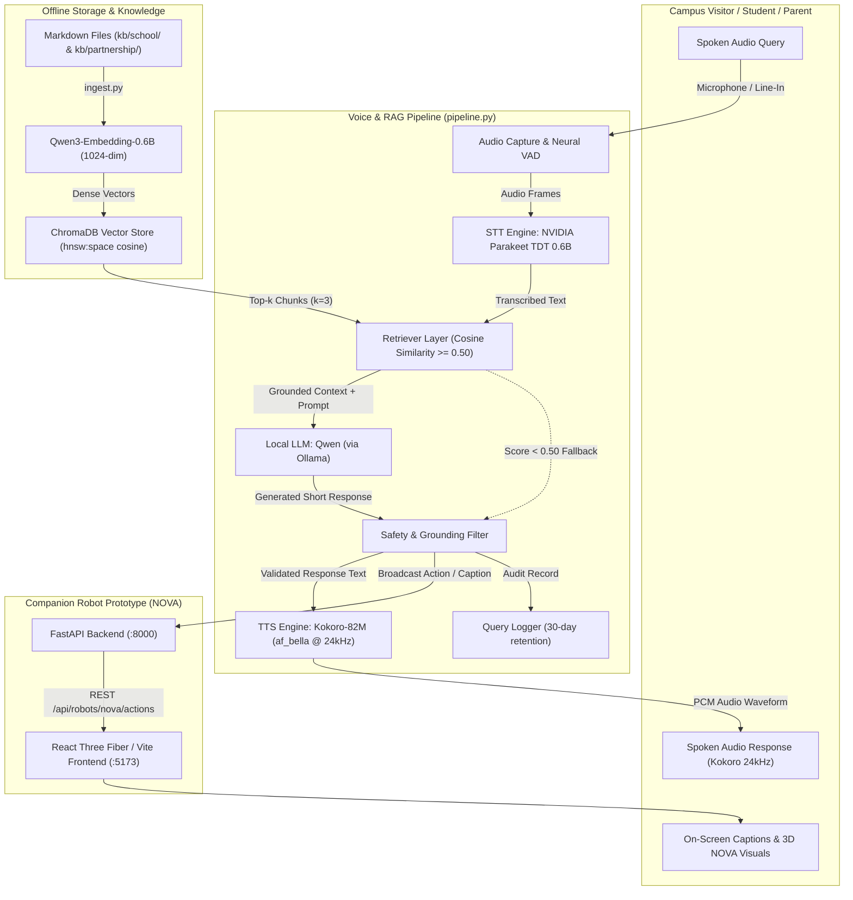
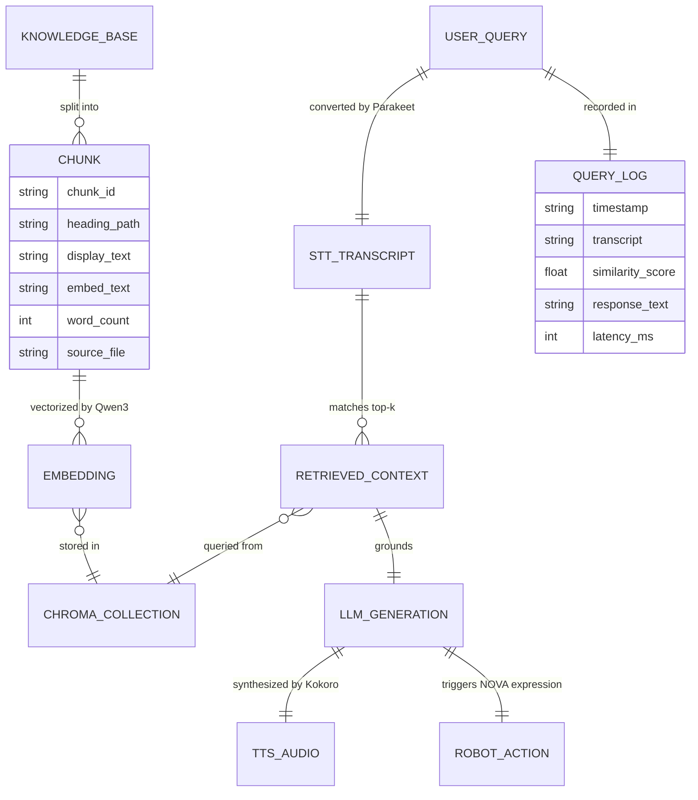

# AI School Ambassador — TEACH & Operations Guide

## 1. Introduction & Background

Visitors, prospective parents, students, and parents frequently need information about school facilities, programmes, schedules, admission procedures, and events. Repeatedly answering routine enquiries increases the workload of administrative staff. Front-desk personnel spend hours each day reiterating school timings, explaining installment deadlines, clarifying uniform policies, or providing directions to laboratories and auditoriums. During peak periods—such as the beginning of an academic term or annual admissions cycles—reception areas experience congestion, phone lines become saturated, and queues lengthen, leading to frustration for both staff and visitors.

This constant influx of repetitive questions creates an operational bottleneck. When administrative teams are consumed by routine queries, their availability for higher-value, sensitive responsibilities—such as managing student welfare issues, supporting parents facing complex circumstances, or processing critical academic records—is significantly curtailed. Furthermore, human fatigue during high-volume periods can lead to inadvertent discrepancies in communicated policies, fee deadlines, or calendar dates.

The **AI School Ambassador** voice kiosk with the **NOVA** 3D companion robot was engineered to solve this dilemma. By deploying a self-contained, fully offline artificial intelligence system on the school premises, Oakridge International Academy and Weguide provide immediate, high-fidelity, spoken responses to everyday questions. The kiosk operates continuously without fatigue, offering a welcoming, warm, and interactive experience for everyone who walks through the school gates.

Crucially, the system is designed with zero external network dependencies and strict hallucination guardrails. It never invents information: every answer is strictly retrieved from an auditable, locally stored knowledge base. When a query falls outside the approved material, the system gracefully directs visitors to the school administration office, ensuring that human staff can focus their expertise where it matters most while automated intelligence handles routine enquiries.

---

## 2. Project Overview for the School Community

The AI School Ambassador is an interactive, voice-activated physical kiosk station powered by NOVA, a soft-futuristic 3D animated companion robot. It is designed to be accessible, intuitive, and trustworthy for all members of the school ecosystem:

### For Students
- **Daily Guidance**: Students can quickly ask about daily class schedules, exam timetables, sports practice timings, club activities, and library operating hours.
- **Engaging & Friendly**: Rather than reading static bulletin boards, students interact with NOVA—a polite, curious, and expressive digital companion who speaks naturally and displays clear text captions.
- **Safe & Private**: The kiosk does not record personal student identities, private grades, or confidential information. All interactions are strictly informational, anonymous, and processed locally in real time.

### For Teachers & Academic Staff
- **Reduced Classroom & Office Distractions**: Routine operational inquiries—such as assembly schedules, school trip itineraries, fee deadlines, and event locations—are handled at the kiosk, minimizing interruptions during office hours and instructional time.
- **Accurate Policy Dissemination**: Teachers can be confident that parents and students receive the exact, officially sanctioned details regarding academic policies, laboratory safety rules, and school events.
- **Partnership Transparency**: Comprehensive details about Weguide robotics clubs, STEM innovation labs, and inter-school competitions are readily available to inspire student participation.

### For Parents & Prospective Visitors
- **Instant Answers, Zero Waiting**: Parents visiting the campus can immediately obtain clarity on admission steps, fee breakdown structures, payment due dates, transport bus routes, and extracurricular offerings without standing in front-desk queues.
- **Audible & Visual Clarity**: Responses are delivered through an expressive, clear female voice (Kokoro-82M *af_bella* at 24 kHz) accompanied by real-time text captions on the kiosk display.
- **Honest & Grounded Assistance**: If an answer requires personal administrative intervention or is not documented in the school’s knowledge base, the system immediately states: *"I don't have that information — please check with the school office."*

---

## 3. Set Up & Execution Guide

Follow these steps to set up, initialize, and execute the complete AI School Ambassador kiosk on a local machine.

### System Prerequisites
- **Operating System**: Windows 10/11, macOS, or Linux.
- **Python**: Version 3.10+ (managed via [`uv`](https://github.com/astral-sh/uv) or standard Python virtual environment).
- **Node.js & npm**: Node.js 18+ and npm installed for the frontend interface.
- **Ollama**: Local Ollama server installed from [ollama.com](https://ollama.com).

---

### Step-by-Step Installation

#### 1. Clone & Navigate to Project
```bash
git clone <repository-url>
cd "School Ambassador"
```

#### 2. Install Python Dependencies
In the `school-ambassador` directory, synchronize the environment using `uv`:
```bash
cd school-ambassador
uv sync
```
*(Alternatively, create a virtual environment using `python -m venv .venv` and install required dependencies).*

#### 3. Download Offline Models
The project operates 100% offline at runtime, but model weights must be present locally:
- **Speech-to-Text (STT) Model**: Run the download helper to fetch the NVIDIA Parakeet TDT 0.6B ONNX model:
  ```bash
  python models/download_parakeet.py
  ```
  *(This populates `models/parakeet-tdt-0.6b-v3/` with `encoder.int8.onnx`, `decoder.int8.onnx`, `joiner.int8.onnx`, and `tokens.txt`).*
- **Text-to-Speech (TTS) Assets**: Verify that `models/kokoro-v0_19.onnx` and `models/voices.json` (containing the `af_bella` voice) are present in `models/`.
- **Local Large Language Model (Ollama)**: In a terminal, pull the grounded language model:
  ```bash
  ollama pull qwen3.5:0.8b
  # Or pull the fallback model:
  ollama pull qwen2.5:0.5b
  ```

#### 4. Configure Environment Files
- **Frontend Environment**:
  ```bash
  cd ../robot-companion-prototype/frontend
  copy .env.example .env
  ```
  Ensure `VITE_API_BASE_URL=http://127.0.0.1:8000`.
- **Backend Environment**:
  ```bash
  cd ../backend
  copy .env.example .env
  ```
  *(Optionally set an `API_TOKEN` or leave empty for local development).*

#### 5. Build and Index the Knowledge Base
Before launching the pipeline, process the structured markdown files in `kb/` into Chroma vector embeddings:
```bash
cd ../../school-ambassador

# Perform a dry-run check
python ingest.py --report

# Index and build the ChromaDB vector database
python ingest.py --rebuild
```

---

### Running the Project (3 Terminals)

To launch the complete interactive voice kiosk, open **three independent terminal windows**:

#### Terminal 1: Robot Companion Backend API
Provides the REST and WebSocket endpoints for triggering physical animations, robot status, and actions.
```bash
cd "c:\Users\manas\OneDrive\Desktop\Weguide\School Ambassador\robot-companion-prototype\backend"
python -m uvicorn main:app --reload --port 8000
```
*Expected output: `Uvicorn running on http://127.0.0.1:8000`.*

#### Terminal 2: Robot Companion 3D Frontend (NOVA)
Launches the 3D WebGL / Three.js interactive UI showing NOVA with real-time expressions and captions.
```bash
cd "c:\Users\manas\OneDrive\Desktop\Weguide\School Ambassador\robot-companion-prototype\frontend"
npm run dev
```
*Expected output: Vite server running on `http://localhost:5173`. Open this URL in your web browser.*

#### Terminal 3: Synchronous Voice & RAG Pipeline
Activates the audio capture, VAD, STT, Chroma retrieval, local LLM, and Kokoro TTS speech synthesis.
```bash
cd "c:\Users\manas\OneDrive\Desktop\Weguide\School Ambassador\school-ambassador"
python pipeline.py
```
*Expected output: System displays audio input device, selected embedding model (`Qwen3-Embedding-0.6B`), and begins listening for spoken questions.*

---

### Visual Runtime Architecture & Entity Relationships

The following diagram illustrates how components and data entities interact during a live voice interaction:





---

## 4. Techniques & Models

The AI School Ambassador leverages cutting-edge, offline-capable Machine Learning (ML), Deep Learning (DL), and Artificial Intelligence (AI) techniques:

| Component | Architecture / Model | Purpose & Implementation Details |
| :--- | :--- | :--- |
| **Voice Activity Detection (VAD)** | **Silero VAD (ONNX)** | Detects speech boundaries with millisecond precision, ignoring background playground, hallway, and cafeteria noise. Dynamically normalizes microphone gain. |
| **Speech-to-Text (STT)** | **NVIDIA Parakeet TDT 0.6B v3** *(FastConformer-TDT)* | Translates spoken audio into text. Operates locally via `sherpa-onnx` using int8 quantized ONNX weights. Boasts high accuracy on conversational speech and school terminology with sub-second latency. |
| **Text Embeddings** | **Qwen3-Embedding-0.6B** *(Fallback: nomic-embed-text-v1.5)* | High-performance 1024-dimensional embedding model with instruction-aware query routing (`Instruct: Given a question asked by a visitor...`). Normalizes vectors for pure cosine distance. |
| **Vector Database** | **ChromaDB (PersistentClient)** | Embedded vector search engine configured with `hnsw:space: cosine`. Computes similarity as $1 - \text{cosine\_distance}$ to retrieve the top $k=3$ most pertinent chunks. |
| **Structure-Aware Chunking** | **Deterministic AST Parser** | Splits documentation along H1–H6 Markdown headers, preserves breadcrumb paths, enforces 20–150 word limits, and augments vector chunks with synthetic spoken questions (`Questions this answers:`). |
| **Language Generation (LLM)** | **Qwen3.5-0.8B / Qwen2.5-0.5B** *(via Ollama)* | Low-parameter generative language model strictly constrained to the retrieved context. Generates concise, ear-friendly answers (1–3 sentences) without creative hallucination. |
| **Safety Guardrails & Fallback** | **Deterministic Threshold Filter** | Enforces a strict cosine similarity floor ($\ge 0.50$). If a query is off-topic or unindexed, the LLM is bypassed and the system outputs the standardized fallback line. |
| **Neural Text-to-Speech (TTS)** | **Kokoro-82M ONNX** | Produces natural 24 kHz speech using the expressive `af_bella` female voice profile. Delivers human-quality prosody and pronunciation on CPU in under 300 ms. |
| **Interactive 3D Visuals** | **Three.js & React Three Fiber** | WebGL-rendered 3D robot companion featuring spring-physics motion, procedural eye expressions (neutral, happy, curious, thinking, listening), and synced mouth/chest light pulses. |

---

## 5. The Do's and Don'ts

To maintain reliability, accuracy, and performance, adhere to these project rules:

### Operational Do's
- **DO keep the system 100% offline at runtime**: All models (STT, Embeddings, LLM, TTS) must run on the local machine. Set offline environment flags (`HF_HUB_OFFLINE=1`, `TRANSFORMERS_OFFLINE=1`) to prevent external network calls.
- **DO use plain synchronous Python**: Keep pipeline logic synchronous and transparent. Intermediate Python developers should be able to trace data flow without handling async race conditions.
- **DO run `ingest.py --report` before rebuilding**: Always run the dry-run analysis after editing markdown files in `kb/` to verify that chunk counts stay within the expected range (35–45 chunks) and that no headings lack query lines.
- **DO write for the ear in knowledge-base files**: Spell out times as `"7:30 AM"`, dates as `"April 10th"`, and state units and currencies explicitly (e.g., `"50 rupees per day"`).
- **DO include `Questions this answers:` in every H2 section**: Supply 2 to 4 colloquial, natural spoken questions separated by ` | ` under each topic heading to enhance retrieval recall.
- **DO rotate backend secrets in production**: Ensure any exposed REST API endpoints use a freshly generated `API_TOKEN`.

### Operational Don'ts
- **DON'T store confidential or private records in `kb/`**: Never include individual student grades, disciplinary records, medical notes, private phone numbers, or residential addresses. The knowledge base is public-facing.
- **DON'T guess or invent missing facts**: If fees, dates, or contact details are unconfirmed, mark them with `[CONFIRM]` in [`kb_review.md`](file:///c:/Users/manas/OneDrive/Desktop/Weguide/School%20Ambassador/school-ambassador/kb_review.md) rather than speculating.
- **DON'T introduce male or secondary TTS voices**: The project is standardized strictly on the Kokoro-82M `af_bella` female voice model at 24 kHz. Do not reintroduce Piper or alternative TTS engines.
- **DON'T lower the similarity threshold recklessly**: Lowering `min_similarity` below 0.40 will permit noisy, out-of-scope queries to pass to the LLM, leading to inaccurate answers and defeating the fallback mechanism.
- **DON'T commit large binaries or `node_modules/` to Git**: Always honor the `.gitignore` settings. Large ONNX binaries, virtual environments, audio caches, and frontend dependencies must remain untracked.
- **DON'T add runtime LLM rewriting loops**: Avoid multi-query expansion, chain-of-thought loops, or multi-agent critique steps at query time. The kiosk must answer spoken questions within a 3–4 second latency budget.

---

## 6. Maintenance & Troubleshooting

| Symptom | Cause | Solution |
| :--- | :--- | :--- |
| **Kiosk outputs fallback for valid questions** | Knowledge base unindexed or threshold set too high. | Run `python ingest.py --rebuild` in `school-ambassador/`. Test question similarity with `python eval_retrieval.py`. |
| **STT fails to transcribe voice** | Parakeet ONNX weights missing or microphone unselected. | Run `python models/download_parakeet.py`. In `config.yaml`, ensure `audio.input_device` points to the active microphone. |
| **TTS produces no sound** | Missing `kokoro-v0_19.onnx` or `voices.json`. | Check that model files exist in `school-ambassador/models/`. Run `python tests/test_audio_roundtrip.py`. |
| **Ollama connection refused** | Ollama daemon is not running. | Launch Ollama from your desktop or execute `ollama serve` in a terminal. |
| **3D robot displays blank canvas** | Node dependencies missing or Vite server inactive. | In `robot-companion-prototype/frontend/`, run `npm install` followed by `npm run dev`. |
| **Need emergency kiosk shutdown** | Immediate maintenance or public pause required. | Create an empty file named `offline.flag` in `school-ambassador/`. The pipeline will pause until the file is removed. |

---

*Document maintained for Oakridge International Academy and Weguide AI School Ambassador Project.*
