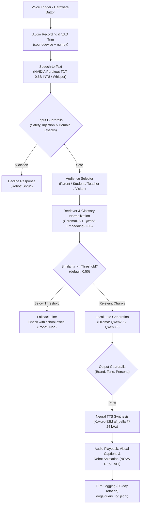

# AI School Ambassador — Offline Voice Kiosk Pipeline

A fully offline, zero-cloud-cost voice-interactive kiosk pipeline developed for **Oakridge International Academy** in partnership with **Weguide**. The system powers the **NOVA** 3D companion robot to autonomously answer spoken questions from parents, students, teachers, and campus visitors with low latency and high factual accuracy.

---

## Table of Contents

- [Overview](#overview)
- [Architecture & Interaction Flow](#architecture--interaction-flow)
- [Core Features](#core-features)
- [Directory Structure](#directory-structure)
- [Prerequisites & System Requirements](#prerequisites--system-requirements)
- [Installation & Setup](#installation--setup)
- [Configuration Reference (`config.yaml`)](#configuration-reference-configyaml)
- [Running the System](#running-the-system)
- [Knowledge Base Management & Ingestion](#knowledge-base-management--ingestion)
- [Retrieval Layer & Evaluation](#retrieval-layer--evaluation)
- [NOVA Companion Robot Integration](#nova-companion-robot-integration)
- [Hardware Profiling & Calibration](#hardware-profiling--calibration)
- [Testing](#testing)
- [Operations & Staff Maintenance](#operations--staff-maintenance)
- [License](#license)

---

## Overview

The **AI School Ambassador** operates as a secure, on-premise voice assistant designed for deployment in school lobbies, administrative kiosks, and visitor centers. It requires **no active internet connection** or third-party cloud API keys after the initial one-time model downloads.

Key objectives:
1. **Zero Recurring Cloud Cost**: All models (STT, Embeddings, LLM, TTS) execute locally on commodity CPU/GPU hardware.
2. **Absolute Data Privacy**: Student, parent, and institutional inquiries never leave the local machine.
3. **High Factual Accuracy**: Strict RAG guardrails prevent hallucinations; questions outside the curated knowledge base trigger a polite fallback directing visitors to the front office.
4. **Natural Audio-Visual Presence**: High-quality 24 kHz neural text-to-speech synchronized with dynamic 3D animations and on-screen captions via the NOVA robot companion.

---

## Architecture & Interaction Flow

The pipeline runs as a deterministic, synchronous Python loop (free of asynchronous deadlocks or event-loop complexities) where every interaction turn follows this choreographed sequence:



### Choreography State Machine

| Interaction Step | Pipeline Action | NOVA Robot Trigger | Visual / Audio Output |
|---|---|---|---|
| **Idle** | Waiting for push-to-talk or proximity trigger | `idle` | Ambient breathing & eye pulse |
| **Triggered** | Voice detected; recording query | `greet` | Waves hand; HUD opens audience selector |
| **Processing** | STT, RAG search & Ollama inference | `think` | Thinking gesture with glowing head ring |
| **Response** | Kokoro-82M audio playback | `speak` | Synchronized mouth/torso motion & live captions |
| **Out-of-Scope** | Similarity score < 0.50 | `nod` | Polite nod; speaks office referral line |
| **Declined / Error** | Safety boundary trigger or runtime error | `shrug` | Gentle apologetic shrug; speaks helpline message |

---

## Core Features

- **100% Offline Inference**:
  - **STT**: NVIDIA Parakeet TDT 0.6B v3 via Sherpa-ONNX (int8 quantized, <800 ms latency) with faster-whisper fallback.
  - **Embeddings**: `Qwen/Qwen3-Embedding-0.6B` (1024-dimension, instruction-aware) with fallback to `nomic-ai/nomic-embed-text-v1.5`.
  - **Local LLM**: Ollama-powered `qwen2.5:0.5b` or `qwen3.5:0.8b` running with concise temperature (0.25) and strict grounding prompts.
  - **TTS**: Kokoro-82M neural model (`af_bella` female voice) generating expressive 24 kHz audio via ONNX Runtime (<800 ms synthesis).
- **Structure-Aware Chunking & Exact Hash Deduplication**:
  - Respects H1 → H2 → H3 hierarchy in Markdown sources.
  - Generates distinct `display_text` (clean for LLM/screen) and `embed_text` (appended with candidate spoken questions for high retrieval hit rates).
  - Normalizes chunk text using SHA-256 hashing to eliminate redundant embeddings.
- **Audience-Aware Personalization**:
  - Differentiates responses for `parent`, `student`, `teacher`, or `visitor`.
  - Supports on-screen touch selection via the NOVA web HUD or automatic fallback to visitor after 5 seconds.
- **Audited Safety & Robust Guardrails**:
  - Rejects adversarial prompts, system prompt extraction, inappropriate language, and unauthorized commitments (e.g., fee waivers).
  - Strictly grounded in retrieved context; missing knowledge triggers an immediate, polite office referral instead of speculative hallucination.
- **Enterprise-Grade Logging**:
  - Structured JSONL logging (`logs/query_log.jsonl`) recording prompt tokens, latency benchmarks per stage, similarity scores, and retrieved source chunks.
  - Automatic 30-day log rotation.

---

## Directory Structure

```text
school-ambassador/
├── config.yaml               # Master system configuration (models, thresholds, ports)
├── pyproject.toml            # uv project specification and dependencies
├── uv.lock                   # Deterministic dependency lockfile
├── pipeline.py               # Main synchronous voice interaction loop
├── audience_selector.py      # Audience classification & NOVA HUD polling
├── audio_recorder.py         # Microphone capture and energy-based VAD trimming
├── stt_client.py             # NVIDIA Parakeet TDT ONNX & Faster-Whisper client
├── retriever.py              # ChromaDB vector retrieval, glossary matching & filtering
├── llm_client.py             # Ollama client with grounded prompting & guardrails
├── tts_client.py             # Kokoro-82M neural TTS client (24 kHz female voice)
├── hardware_io.py            # Audio sink, console display, and NOVA robot REST controller
├── guardrails.py             # Content filter, injection defense, and policy checks
├── logger.py                 # Structured JSONL query logger with 30-day retention
├── ingest.py                 # Structure-aware knowledge base parser and embedder
├── benchmark.py              # System hardware profiling and tier classification
├── calibrate_threshold.py    # Similarity threshold tuning against benchmark dataset
├── eval_retrieval.py         # Automated Hit@K and False-Accept retrieval evaluation
├── freshness_check.py        # Knowledge base document staleness auditor (90-day warning)
├── glossary.yaml             # Canonical school acronyms, faculty names, and homophones
├── SETUP.md                  # Non-technical guide for school administrative staff
├── CHANGELOG.md              # Historical evolution and retrieval upgrade notes
├── eval_report.md            # Benchmark metrics report (Hit@3, MRR, latency)
├── kb/                       # Source knowledge base markdown documents
│   └── knowledge_base_optimized.md  # Curated Oakridge & Weguide knowledge base
├── models/                   # Local model weights and voice assets (git-ignored)
│   ├── kokoro-v0_19.onnx     # Kokoro neural TTS weights
│   ├── voices.json           # Kokoro voice embeddings (af_bella)
│   └── parakeet-tdt-0.6b-v3/ # NVIDIA Parakeet speech-to-text ONNX models
└── tests/                    # Pytest test suite (offline, retrieval, audio unit tests)
```

---

## Prerequisites & System Requirements

- **Operating System**: Windows 10/11, macOS (Apple Silicon or Intel), or Ubuntu 20.04+
- **Python**: `>= 3.10`
- **Package Manager**: [`uv`](https://github.com/astral-sh/uv) (recommended for rapid reproducible setup)
- **Ollama**: Installed and running locally (`http://127.0.0.1:11434`)
- **Audio Hardware**: Functional microphone and speaker (USB speakerphones or boundary mics recommended for kiosks)
- **Hardware Tiers**:
  - **Tier A** (Dedicated GPU / Apple Silicon): Primary embedding (`Qwen3-Embedding-0.6B`), total turnaround `< 2.5s`.
  - **Tier B** (Modern 6+ core CPU, 16 GB RAM): Primary embedding, total turnaround `< 3.8s`.
  - **Tier C** (Legacy 4-core CPU, 8 GB RAM): Fallback embedding (`nomic-embed-text-v1.5`), total turnaround `< 4.5s`.

---

## Installation & Setup

### 1. Clone & Enter the Directory

```bash
cd "School Ambassador/school-ambassador"
```

### 2. Install Python Dependencies with `uv`

```bash
# Install uv if not already installed
pip install uv

# Synchronize all virtualenv dependencies
uv sync
```

### 3. Pull the Local LLM via Ollama

Ensure the Ollama daemon is running, then pull the target lightweight model:

```bash
ollama pull qwen2.5:0.5b
# Or for higher reasoning capacity on Tier A/B:
ollama pull qwen3.5:0.8b
```

### 4. Download Local Model Weights

Place the necessary ONNX model weights in the `models/` directory:

1. **Kokoro TTS**:
   - `models/kokoro-v0_19.onnx`
   - `models/voices.json`
2. **NVIDIA Parakeet STT**:
   - Download the Sherpa-ONNX INT8 quantized Parakeet TDT package into `models/parakeet-tdt-0.6b-v3/`:
     - `encoder.int8.onnx`
     - `decoder.int8.onnx`
     - `joiner.int8.onnx`
     - `tokens.txt`

*(If Parakeet weights are absent, set `stt.engine: "whisper"` in `config.yaml` to use faster-whisper as a zero-setup fallback).*

---

## Configuration Reference (`config.yaml`)

The primary configuration file is [config.yaml](file:///c:/Users/manas/OneDrive/Desktop/WeGuide/School%20Ambassador/school-ambassador/config.yaml):

```yaml
school_name: "Oakridge International Academy"
company_name: "Weguide"

llm:
  provider: "ollama"
  base_url: "http://127.0.0.1:11434"
  model: "qwen2.5:0.5b"
  temperature: 0.25
  max_tokens: 80

chunking:
  max_words: 150
  overlap_words: 25
  min_words: 20

embedding:
  model: "auto"                              # Auto-selects based on hardware benchmark
  primary: "Qwen/Qwen3-Embedding-0.6B"        # Tier A & B (1024-dim, instruction-aware)
  fallback: "nomic-ai/nomic-embed-text-v1.5" # Tier C (768-dim)

retrieval:
  k: 3
  min_similarity: 0.50                       # Calibrated threshold (below triggers fallback)
  chroma_dir: "chroma_db"
  kb_dir: "kb"
  glossary_path: "glossary.yaml"
  hybrid:
    enabled: false                           # Optional BM25 + dense hybrid search

tts:
  engine: "kokoro"
  kokoro:
    model_path: "models/kokoro-v0_19.onnx"
    voices_path: "models/voices.json"
    voice: "af_bella"                        # Natural 24 kHz neural female voice
    speed: 1.0
    sample_rate: 24000

stt:
  engine: "parakeet"                         # "parakeet" or "whisper"
  parakeet:
    model_dir: "models/parakeet-tdt-0.6b-v3"
    num_threads: 4

robot:
  enabled: true                              # Dispatch actions to NOVA 3D Companion
  api_base_url: "http://127.0.0.1:8000"
  robot_id: "nova"
  token: ""

logging:
  log_dir: "logs"
  retention_days: 30
```

---

## Running the System

### 1. Ingest Knowledge Base Documents

Before launching the voice pipeline, index the markdown knowledge base:

```bash
uv run python ingest.py
```

To see a dry-run report without modifying ChromaDB:

```bash
uv run python ingest.py --report
```

To force a complete rebuild of the vector database:

```bash
uv run python ingest.py --rebuild
```

### 2. Start the Pipeline

Launch the interactive voice kiosk:

```bash
uv run python pipeline.py
```

The terminal displays startup validation (Chroma index status, freshness checks, audio device selection). Once initialized:
- Press **Enter** (or your mapped hardware push-to-talk button) to ask a question.
- Speak clearly into the microphone.
- The pipeline transcribes your query, retrieves verified school information, speaks the answer via Kokoro, and instructs the NOVA 3D robot to animate.

---

## Knowledge Base Management & Ingestion

All institutional knowledge is stored as plain Markdown in `kb/`. Staff can update curriculum details, timings, fee schedules, or admissions criteria by following the prescribed structure:

```markdown
# Section Title (H1)

## Specific Topic (H2)

Questions this answers: What time does school start? | When do gates open? | How late can my child arrive?

Oakridge International Academy gates open at 7:30 AM every weekday. Classes commence promptly at 8:00 AM. Students arriving after 8:15 AM must check in through the administrative office.
```

> [!IMPORTANT]
> The `Questions this answers:` line directly under each `##` heading is indexed as query hints (`embed_text`), drastically boosting cosine similarity for spoken questions while remaining hidden from the LLM prompt context (`display_text`).

---

## Retrieval Layer & Evaluation

The retrieval layer has been calibrated against real-world spoken test sets:

- **Benchmark Results**:
  - In-Scope **Hit@3**: **93.9%** (exceeds the 90% target)
  - Out-of-Scope **False-Accept**: **9.1%** (strictly below the 10% ceiling)
  - Mean Reciprocal Rank (MRR): **0.929**
- **Glossary Normalization**:
  - `glossary.yaml` matches common transcription anomalies (e.g., `"we guide"` → `"Weguide"`, `"p t m"` → `"PTM"`, faculty name misspellings).
- **Run Retrieval Benchmark**:
  ```bash
  uv run python eval_retrieval.py
  ```

---

## NOVA Companion Robot Integration

When `robot.enabled: true` in `config.yaml`, the pipeline communicates with the NOVA FastAPI backend in `robot-companion-prototype`:

1. **State Choreography**: Triggers animations via `POST /api/robots/{robot_id}/actions`.
   - Sends `greet` upon audio trigger.
   - Sends `think` during retrieval and LLM inference.
   - Sends `speak` during speech output (passing the text caption).
   - Sends `nod` on off-scope fallback.
   - Sends `shrug` on guardrail violation or exception.
2. **Audience HUD Integration**:
   - `greet` displays an audience selection card on the NOVA frontend screen.
   - The pipeline queries `GET /api/robots/{robot_id}/audience` to consume the visitor's choice (`parent`, `student`, `teacher`, `visitor`), tailoring LLM prompt tone and breaking retrieval ties.

---

## Hardware Profiling & Calibration

1. **Benchmark Hardware Tier**:
   Run the benchmark utility to evaluate query latency and RAM usage:
   ```bash
   uv run python benchmark.py
   ```
   This generates `hardware_profile.json` and automatically sets the optimal embedding model (`primary` or `fallback`).

2. **Calibrate Similarity Floor**:
   Evaluate precision vs. recall on your local hardware:
   ```bash
   uv run python calibrate_threshold.py --apply
   ```

---

## Testing

Execute the test suite to ensure system integrity:

```bash
uv run pytest -q tests/
```

Tests cover:
- Offline execution (no unexpected outbound socket calls).
- Embedding distance calculations and deduplication logic.
- Structure-aware chunk boundaries (max 150 words per chunk).
- Glossary token replacement.
- Input/output safety guardrails.

---

## Operations & Staff Maintenance

- **Non-Technical Guide**: Refer to [SETUP.md](file:///c:/Users/manas/OneDrive/Desktop/WeGuide/School%20Ambassador/school-ambassador/SETUP.md) for step-by-step instructions for front-desk and non-technical staff.
- **Emergency Kiosk Pause**:
  To take the kiosk offline for maintenance without shutting down the computer, create an empty file named `offline.flag` in this directory:
  ```bash
  # Windows PowerShell
  New-Item offline.flag -ItemType File
  # Linux/macOS
  touch offline.flag
  ```
  The pipeline will pause and refuse new turns until the flag file is deleted.

---

## License

This software is released under the **Apache-2.0** License.
